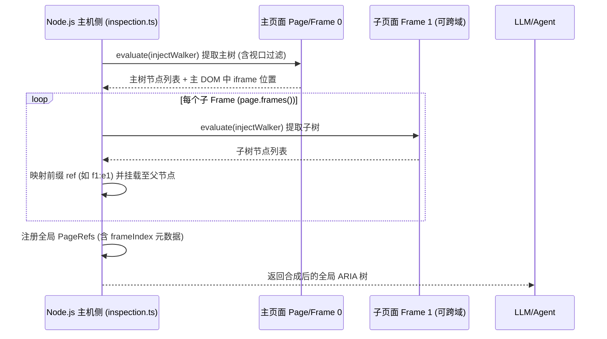
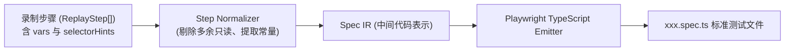

# dsh-browser-view v0.5.0 详细实现方案: 架构微调与高阶能力落地

> **版本**：v0.5.0  
> **状态**：方案定稿（已融合架构审查与解耦优化）  
> **指导思想**：
> 1. **架构正交性**：严格划分定位、树合成、组件适配与代码生成职责，不让特异性逻辑污染工具门面；
> 2. **零 DOM 污染与状态安全**：视觉与快照层坚决不破坏页面的 DOM 树与稳态检测（Quiescence）；
> 3. **零新增第三方运行时依赖**：100% 原生 TypeScript 与 Playwright 编排；
> 4. **完全向前兼容**：既有 36 个工具入参出参语义不变，默认行为零差异，全部已有测试持续通过。

---

## 一、 架构调整与模块全景映射

针对前期架构推演中发现的潜在耦合，v0.5.0 对模块职责做出了清晰划分：

```
src/browser/
├── adapters/                  # [组件库层]
│   ├── types.ts               # UIAdapter 规范扩展: 增加 fillFormField 协议
│   ├── generic.ts             # 原生 input/select/textarea 基础表单项实现
│   ├── antd.ts                # Ant Design 表单项反查、浮层与受控组件填写
│   ├── element.ts             # Element Plus 表单项反查与特殊组件填写
│   └── registry.ts            # 适配器调度中心
├── session/                   # [会话调度与定位解析层]
│   ├── cache.ts               # 快照版本环形缓存与 Ref 注册表 (扩展 FrameIndex)
│   ├── target.ts              # [新增] 统一目标解析门面 resolveTargetLocator
│   └── screenshot.ts          # 截图管道与 SoM 离屏渲染合成
├── codegen/                   # [代码生成层]
│   └── playwright.ts          # [新增] 原生 Playwright Spec 编译器管道
├── walker.ts                  # [页内单文档遍历] 增加纯几何视口相交剪枝 isElementInViewport
├── tools/                     # [工具门面调度层]
│   ├── inspection.ts          # 主机端 Frame 树合成 + 视口局部快照 + SoM 标徽截图
│   ├── interaction.ts         # 全面接入 resolveTargetLocator + 调度 browser_form_fill
│   └── recorder.ts            # 录制管理接入 codegen/playwright 导出管道
└── register.ts                # 工具注册 (36 -> 37 个工具，更新 Schema)
```

---

## 二、 核心模块详细设计与实现规范

### 模块 1：统一目标解析门面（Target Resolution Pipeline）

#### 1.1 职责与目标
彻底解决“跨域/同域 IFrame 内元素无法被 `page.locator()` 定位”的问题，将 IFrame 的探测与选择器分发收敛至底层，上层动作工具（`click`, `type`, `select` 等）无感复用。

#### 1.2 类型与数据结构扩展 ([src/browser/types.ts](file:///Users/zhangbei/code/dsh-browser/src/browser/types.ts))
```ts
export interface RefEntry {
  role: string;
  name: string;
  selector: string;
  /** 元素所在 Frame 的全局索引 (0 为主 Frame, >=1 为子 Frame) */
  frameIndex?: number;
  /** 元素所在 Frame 的当前 URL，用于导航防漂移二次校验 */
  frameUrl?: string;
}

export interface TargetResolution {
  /** 可直接调用的 Playwright Locator (自动绑定在主 Page 或对应 Frame 上) */
  locator: Locator;
  /** 执行上下文容器 (Page 或 Frame) */
  container: Page | Frame;
  /** 对应的元数据条目 (仅 ref 模式有效) */
  entry?: RefEntry;
  /** 跨 Frame 标记 */
  isIFrame: boolean;
}
```

#### 1.3 核心实现 ([src/browser/session/target.ts](file:///Users/zhangbei/code/dsh-browser/src/browser/session/target.ts))
```ts
import type { Page, Frame, Locator } from "playwright-core";
import { pageRef } from "./cache.js";
import type { TargetResolution } from "../types.js";

/**
 * 统一目标解析器: 无论传入 CSS 选择器还是 ref，均返回正确的 Locator 与 Frame 上下文
 */
export function resolveTargetLocator(
  page: Page,
  target: { ref?: string; selector?: string }
): TargetResolution {
  if (target.ref) {
    const entry = pageRef(page, target.ref);
    if (!entry) {
      throw new Error(`未找到引用的元素 [ref=${target.ref}], 快照可能已过期或页面发生导航`);
    }

    // 若元素位于子 Frame
    if (typeof entry.frameIndex === "number" && entry.frameIndex > 0) {
      const frames = page.frames();
      const targetFrame = frames[entry.frameIndex];
      if (!targetFrame) {
        throw new Error(`引用元素所在的子 Frame (index=${entry.frameIndex}) 已销毁`);
      }
      return {
        locator: targetFrame.locator(entry.selector),
        container: targetFrame,
        entry,
        isIFrame: true,
      };
    }

    // 默认主 Frame
    return {
      locator: page.locator(entry.selector),
      container: page,
      entry,
      isIFrame: false,
    };
  }

  if (target.selector) {
    return {
      locator: page.locator(target.selector),
      container: page,
      isIFrame: false,
    };
  }

  throw new Error("必须提供 ref 或 selector 参数定位目标");
}
```

---

### 模块 2：主机端跨 Frame 语义树合成器与视口过滤

#### 2.1 职责与目标
解决跨域 IFrame 内联 JS 因同源策略报 `SecurityError` 的问题，同时支持长页面的视口局部快照（Token 降低 60%~85%）。

#### 2.2 页内 Walker 扩展 ([src/browser/walker.ts](file:///Users/zhangbei/code/dsh-browser/src/browser/walker.ts))
保持纯函数自包含特性，仅增加只读的视口相交判定：
```ts
function __walkerCore() {
  // ...保持已有角色、名称提取与 describeElement 逻辑不变...

  /** 纯只读几何判定: 元素是否在当前视口范围内 (不修改 DOM，不触发回流) */
  function isElementInViewport(el: Element, padding = 0): boolean {
    const rect = el.getBoundingClientRect();
    const winHeight = window.innerHeight || document.documentElement.clientHeight;
    const winWidth = window.innerWidth || document.documentElement.clientWidth;
    // 面积为 0 或隐藏节点由 isVisible 过滤，此处仅做坐标交集
    return (
      rect.bottom >= -padding &&
      rect.right >= -padding &&
      rect.top <= winHeight + padding &&
      rect.left <= winWidth + padding
    );
  }

  return { ..., isElementInViewport };
}
```

#### 2.3 主机端树合成器 ([src/browser/tools/inspection.ts](file:///Users/zhangbei/code/dsh-browser/src/browser/tools/inspection.ts))


---

### 模块 3：零 DOM 污染的多模态 SoM（Set-of-Marks）渲染器

#### 3.1 职责与目标
为多模态模型（Claude 3.5 Sonnet / GPT-4o / Gemini 1.5 Pro）提供**绝对精准的视觉锚点**，且**坚决不插入真实 DOM 节点**，避免破坏 `MutationObserver` 稳态检测。

#### 3.2 离屏 Canvas 合成架构
- **机制**：
  1. 通过 `page.screenshot({ type: "png" })` 获取原始视口截图 Buffer；
  2. 提取当前视口内可见交互元素的坐标信息数组 `marks: Array<{ id, x, y, width, height, ref, name, role }>`；
  3. 利用页内临时 `OffscreenCanvas`（纯离屏内存渲染，不挂载到 DOM 树）或 Node 侧轻量画笔绘制纯色半透明徽章与白底粗体数字；
  4. 产出合成后的带标徽截图落盘工作区。
- **降级保护**：若浏览器环境不支持 `OffscreenCanvas`，采用极速临时 SVG 图层：
  - 仅在截眼前一帧挂载 `id="__dsh_som__"`，设置 `pointer-events: none; contain: strict;`，并在 `quiescence.ts` 中将 `__dsh_som__` 设为 MutationObserver 忽略黑名单；
  - 截图动作完成后在 `finally` 块中立即 `.remove()`。

---

### 模块 4：适配器驱动的高阶表单批量填充原语 (`browser_form_fill`)

#### 4.1 职责与目标
将表单批量填写的往返调用（通常 10~20 轮）压缩为 **1 轮原子化操作**；同时通过组件库适配器自动识别 Ant Design、Element Plus 或原生表单的不同控件交互形态。

#### 4.2 适配器协议扩展 ([src/browser/adapters/types.ts](file:///Users/zhangbei/code/dsh-browser/src/browser/adapters/types.ts))
```ts
export interface FormFieldItem {
  key: string;       // 对应 Label、Placeholder、Name 或 Selector
  value: any;        // 填入的值 (文本、数字、布尔、选项文本、日期字符串等)
}

export interface FormFillResult {
  filled: string[];
  skipped: string[];
  errors: Record<string, string>;
  submitted: boolean;
}

export interface UIAdapter {
  // ...既有 matches, selectOption, actionInterceptor 协议...

  /**
   * 尝试使用组件库特异性逻辑填充单个表单项
   * @returns handled: true 表示适配器已成功处理; false 表示交由通用兜底
   */
  fillFormField?(
    page: Page,
    field: FormFieldItem,
    scope?: string
  ): Promise<{ handled: boolean; error?: string }>;
}
```

#### 4.3 工具门面调度流程 ([src/browser/tools/interaction.ts](file:///Users/zhangbei/code/dsh-browser/src/browser/tools/interaction.ts))
1. 获取当前页面激活的 `activeAdapter`；
2. 依次遍历传入的 `fields` 键值对：
   - 优先调用 `activeAdapter.fillFormField(page, field, scope)`；
   - 若未处理（`handled: false`），由通用逻辑根据 `label` 反查关联 `<input>`, `<select>`, `<textarea>` 执行默认输入；
   - 每次成功变更触发微弱的 `waitForQuiescence(page, { quietMs: 60 })` 稳态等待，保证联动校验和级联下拉平稳就绪；
3. 若传入了 `submitButton`（选择器或名称如 `"保存"`），通过 `resolveTargetLocator` 执行最终点击；
4. 汇总返回 `{ filled, skipped, errors, submitted }`，单项报错不中断全局。

---

### 模块 5：独立代码生成编译器管道（Playwright Spec Emitter）

#### 5.1 职责与目标
将录制出的 JSON 规范序列无缝转译为标准 TypeScript Playwright E2E 测试用例，打破插件私有录制格式的壁垒。

#### 5.2 编译器模块架构 ([src/browser/codegen/playwright.ts](file:///Users/zhangbei/code/dsh-browser/src/browser/codegen/playwright.ts))



#### 5.3 核心转译映射规则
| 录制动作 | 编译输出的 Playwright 原生代码 |
| :--- | :--- |
| `browser_open { url }` | `await page.goto('${url}');` |
| `browser_click { selector }` | `await page.locator('${selector}').click();` |
| `browser_type { selector, text }` | `await page.locator('${selector}').fill('${text}');` |
| `browser_select { selector, option }` | `await page.locator('${selector}').selectOption({ label: '${option}' });` |
| `browser_wait_for { selector, state }` | `await page.locator('${selector}').waitFor({ state: '${state}' });` |
| `browser_assert { selector, text }` | `await expect(page.locator('${selector}')).toContainText('${text}');` |
| 参数化占位符 `{{username}}` | 提取为顶层 `test('...', async ({ page }, testInfo) => { const { username } = ... })` |

---

## 三、 测试与质量验证计划

沿用项目完善的契约测试与状态隔离体系，新增以下测试用例集：

| 测试文件名 | 覆盖核心逻辑 |
| :--- | :--- |
| `test/target-resolver.test.ts` (新) | 主 Frame 与多 Frame 隔离定位、已销毁 Frame 优雅报错、Ref 命名空间防串线 |
| `test/viewport-snapshot.test.ts` (新) | 几何相交剪枝、视口滚动后增量快照、`viewportPadding` 边距生效性 |
| `test/form-fill.test.ts` (新) | 批量字段填写、AntD/Element 特殊控件桥接、部分字段报错聚合不崩会话 |
| `test/som-rendering.test.ts` (新) | 离屏标徽生成、无 DOM 污染断言（DOM 树前后 hash 校验）、映射 ID 一致性 |
| `test/codegen-playwright.test.ts` (新) | 录制步骤到 TypeScript 源码转译、变量提升、格式规范性语法检查 |
| `test/output-contract.test.ts` (扩展) | 工具总数增至 37 个，校验 `browser_form_fill` 及新增参数的所有 outputSchema |

---

## 四、 实施波次与任务分解

```
波次一 (P0 核心架构解耦与穿透):
  Task 1.1: 实现 TargetResolution 门面并在原有交互工具中落地
  Task 1.2: Walker 视口几何剪枝与主机端 Frame 树合成
  Task 1.3: 编写 Frame 穿透与视口剪枝单元测试

波次二 (P1 高阶能力与多模态赋能):
  Task 2.1: 扩展 UIAdapter 表单项协议并在 AntD / Generic 适配器中实现
  Task 2.2: 落地 browser_form_fill 工具注册与批量调度
  Task 2.3: 实现零 DOM 污染 SoM 视口标徽与映射输出
  Task 2.4: 编写表单填充与 SoM 视觉测试用例

波次三 (P2 测试工程化与发布收尾):
  Task 3.1: 独立实现 codegen/playwright.ts 编译器管道
  Task 3.2: 扩展 browser_record export 动作
  Task 3.3: 运行完整 verify (Typecheck + Lint + 28套全量测试 + Build)
  Task 3.4: 更新 README.md 与发布说明
```
