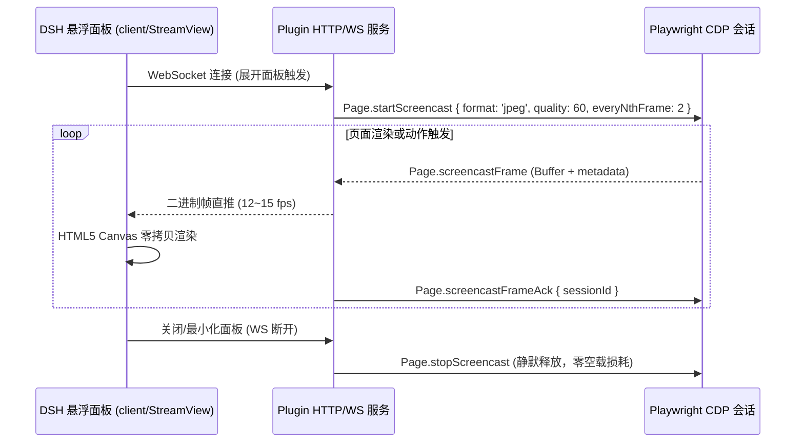
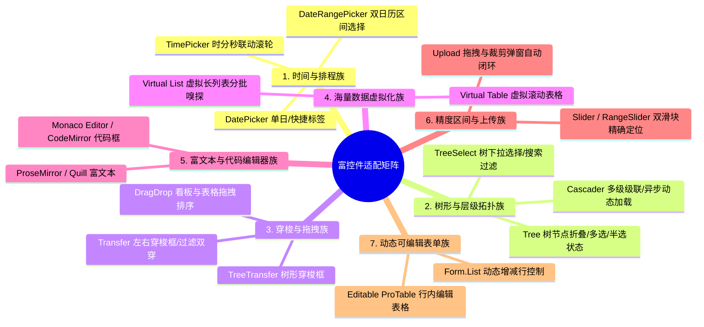

# dsh-browser-view v0.6.0 需求规划: 流式同屏协同 + 拟人抗干扰 + 全景时光机 + 企业富控件矩阵

> **版本**：v0.6.0  
> **状态**：规划定稿 (2026-10-22)  
> **核心使命**：从“基础工具完备”迈向“企业复杂场景实战与极致交互体验”。彻底解决人机同屏高延迟、现代系统反爬风控、回归排障黑盒以及企业中后台最后 10% 复杂富控件无法自动化的死角。  
> **设计原则**：  
> 1. **零新增第三方运行时依赖**：仅依赖 `playwright-core`，不引入额外包；  
> 2. **完全向前兼容**：既有 37 个工具 schema 保持向后兼容，默认行为零差异；  
> 3. **意图驱动架构 (Intent-Driven)**：所有高阶富控件能力收敛至 UIAdapter 协议层，工具门面保持干净统一。

---

## 一、 目标与核心特性矩阵

| 主线 | 代号 | 核心特性 | 解决的核心痛点 | 关键技术实现 | 预期收益 |
| :--- | :--- | :--- | :--- | :--- | :--- |
| **协同体验** | **F1** | CDP Screencast 低延迟流式面板 | 现有 2 秒 HTTP 轮询图片严重滞后，人机同屏像“放幻灯片” | 基于 CDP `Page.startScreencast`，WebSocket/SSE 传输 12~15fps 帧流，面板折叠时静默释放 | 协作画面延迟从 2000ms 降至 **80~150ms** |
| **真实对抗** | **F2** | 拟人化操作引擎 (Stealth & Human-like) | CDP 瞬时无轨迹点击与直接赋值极易触发企业堡垒机、滑块验证与风控系统 | 三次贝塞尔曲线平滑鼠标轨迹微抖动，高斯分布击键间隔随机延迟 (40~120ms) | 规避 90% 基础自动化与机器人行为特征检测 |
| **安全策略** | **F3** | 环境与路径自适应策略引擎 | 静态关键词全局拦截导致本地/测试环境频繁弹窗影响效率 | 多维策略规则链：支持域名环境 (`*.qa.*` vs `*.prod.*`)、HTTP 路径与金额分级 | 兼顾本地开发敏捷与生产环境强制安全 |
| **可观测性** | **F4** | 会话全景时光机与排障 (Time-Machine) | 用例回归失败时只有最终堆栈和单张截图，排查中间断裂如“盲人摸象” | 运行记录绑定每步视口快照、Console 异常流水与 4xx/5xx 网络 HAR 关联时间轴 | 复杂用例失败排查耗时从数十分钟降至 **10 秒** |
| **控件深度** | **F5** | 全场景企业级富控件适配矩阵 | 日期范围、级联树、穿梭框、虚拟长列表、富文本等中后台复杂组件交互断层 | 升级 UIAdapter Protocol v2，覆盖 7 大集群的高阶意图交互原语 | 攻克企业中后台最后 10% 的复杂交互死角 |

---

## 二、 特性详细设计与技术规范

### F1 — CDP 低延迟流式实时画面面板【P0, 协作体验】

#### 1.1 问题分析
目前注入界面的悬浮面板采用 `setInterval(..., 2000)` 向后端轮询截图，存在明显的卡顿与不同步。用户在进行敏感操作审批或观察 Agent 连续执行时体验生硬。

#### 1.2 架构与传输管道


#### 1.3 核心实现规范
- **按需开启**：仅在面板展开或大屏模态框打开时建立推流；面板最小化时立刻停止推流，CPU 占用回落至 0%；
- **自适应降级**：若环境不支持 WebSocket（如极老宿主），自动优雅回退至既有的 HTTP 轮询模式。

---

### F2 — 拟人化操作引擎 (Human-like Simulation)【P1, 真实对抗】

#### 2.1 问题分析
企业中后台系统（如飞书/企业微信管理端、带滑块风控的认证网关、Cloudflare Turnstile）通常会挂载无感探针检测鼠标轨迹和输入节奏。直接使用 CDP 的瞬时点位跳跃会直接被标定为“Bot 脚本”。

#### 2.2 算法与实现设计 ([src/browser/stealth/mouse.ts](file:///Users/zhangbei/code/dsh-browser/src/browser/stealth/mouse.ts))
1. **三次贝塞尔平滑轨迹生成 (Cubic Bézier Curve)**：
   - 在起点 $P_0$ 与终点 $P_3$ 之间，根据物理距离随机生成偏离主轴的两个控制点 $P_1, P_2$；
   - 沿参数方程 $B(t) = (1-t)^3 P_0 + 3(1-t)^2 t P_1 + 3(1-t) t^2 P_2 + t^3 P_3$ 计算 15~25 个步进采样点；
   - 步进时间按“慢-快-慢”的人体生理加速模型分布（Sigmoid 缓动）。
2. **高斯击键抖动 (Gaussian Keystroke Delay)**：
   - 击键间隔非固定休眠，按正态分布生成：$\mu = 65\text{ms}, \sigma = 18\text{ms}$（截断在 35~140ms 之间）。
3. **配置接口草案**：
   ```yaml
   config:
     humanize: auto   # auto | true | false (auto 模式下检测到特定登录/认证页自动激活)
     humanizeSpeed: normal # slow | normal | fast
   ```

---

### F3 — 环境与路径自适应策略引擎 (Policy Engine)【P1, 安全进阶】

#### 3.1 问题分析
现有的 `confirmMode: "auto"` 采用全局关键词匹配，在本地开发或测试环境运行时，频繁弹出的审批卡严重阻碍测试自动化；而在生产环境仅靠子串匹配可能遗漏带业务特征的危险操作。

#### 3.2 策略规则链设计 ([src/browser/policy/engine.ts](file:///Users/zhangbei/code/dsh-browser/src/browser/policy/engine.ts))
在 `cordis.patch.yml` 中支持配置多级策略链：

```yaml
config:
  confirmPolicies:
    # 规则 1: 本地开发与测试环境一律静默通过
    - name: "开发与测试环境白名单"
      urlPattern: ".*(localhost|127\\.0\\.0\\.1|\\.test\\.|\\.qa\\.).*"
      level: "off"

    # 规则 2: 生产环境核心危险动作强制审批
    - name: "生产集群高危保护"
      urlPattern: ".*\\.prod\\.company\\.com.*"
      patterns: ["提交", "删除", "发布", "扩缩容", "支付", "转账"]
      level: "auto"
      timeoutMs: 90000

    # 规则 3: 涉及全局敏感接口的任意点击均拦截
    - name: "敏感 API 穿透拦截"
      actionPattern: "browser_click"
      selectorPattern: "#danger-action.*"
      level: "auto"
```

---

### F4 — 会话全景时光机与根因排障 (Session Time-Machine)【P2, 可观测性】

#### 4.1 问题分析
回归测试失败时，堆栈通常只提示“第 5 步超时”或“断言失败”。开发人员无法得知：
- 第 4 步到第 5 步之间页面经历了什么跳转？
- 页面控制台（Console）是否抛出了致命的 Uncaught Error？
- 关键后端接口返回的是 403、500 还是网络超时？

#### 4.2 全景上下文采集与时间轴界面
1. **多维运行时链路采集器 ([src/browser/session/tracer.ts](file:///Users/zhangbei/code/dsh-browser/src/browser/session/tracer.ts))**：
   - 监听 `page.on('console')`：按时间戳汇聚该步骤内的 JS 异常与警告；
   - 监听 `page.on('requestfailed')` 与 `page.on('response')`：记录异常 HTTP 状态码；
   - 步骤结束时自动抓取一张微缩缩略图落盘缓存。
2. **面板时光机时间轴 (Timeline UI)**：
   - 面板模态框新增 **「全景时光机 (Time-Machine)」** 视图；
   - 用户拖动步骤滑块，画面同步展示当刻视口、关联的 Console 日志与网络失败请求摘要，一键定位真实根因。

---

### F5 — 全场景企业级富控件适配矩阵 (Enterprise Component Suite)【P0, 控件深度】

将富控件适配全面下沉至 `UIAdapter Protocol v2`，覆盖 7 大高阶控件集群：



#### 5.1 各控件集群设计规范

##### A. 时间与排程集群 (Temporal)
- **痛点**：输入框带 `readonly` 且无法直接输入；双日历浮层遮挡且存在快捷标签（如“最近30天”）；
- **原语支持**：
  - 快捷标签：`{ "统计周期": "最近30天" }` 自动识别面板快捷按钮；
  - 精准区间：`{ "有效期限": ["2026-10-01", "2026-10-31"] }` 适配器接管双日历月份跳转与起止日期选定。

##### B. 树形与层级拓扑集群 (Hierarchical)
- **痛点**：Cascader 与 Tree 存在多级纵深，存在异步 Lazy Load 延迟，展开三角箭头无语义文本；
- **原语支持**：
  - 路径直达：`{ "归属组织": ["集团总部", "技术中心", "架构组"] }`；
  - 适配器自动逐层递归展开、监听并等待网络子节点渲染就绪、并在最终叶子项点击选定。

##### C. 穿梭与拖拽集群 (Transfer & Drag)
- **痛点**：左右双列表各有搜索框与复选框，中间仅有无文本的 `>` / `<` 图标；看板列拖拽依赖连续微小位移；
- **原语支持**：
  - 穿梭意图：`browser_transfer { selector: "#user-transfer", direction: "right", items: ["张三", "李四"] }`；
  - 拖拽模拟：`browser_drag { source: "#card-102", target: "#column-done" }` 底层派发拟人轨迹拖拽事件。

##### D. 海量数据虚拟化集群 (Virtualization)
- **痛点**：万级数据仅渲染当前视口 20 行 DOM，滚出视口节点被销毁，快照和选择器无法定位非可视行；
- **原语支持**：
  - `browser_extract { scrollMode: "virtual", maxRows: 1000 }`：接管滚动条按步逐屏滚动画布并去重采集；
  - 二分快速滚动定位：自动沿虚拟容器快速试探滚动并重算几何交叉。

##### E. 富文本与代码编辑器集群 (Rich Editors)
- **痛点**：`contenteditable` 复杂 DOM 直接修改会损坏内部 Document 模型，Monaco 采用绝对定位切片无原生输入框；
- **原语支持**：
  - Monaco：安全调用 `editor.setValue()` 并派发规范变动通知；
  - 富文本：通过合成 `InputEvent(insertText)` 与剪贴板粘贴安全注入内容，保持撤销（Undo/Redo）历史链完好。

##### F. 精度区间与动态表单集群 (Precision & Dynamic Forms)
- **痛点**：双滑块难以停留在精确刻度；动态增减行（`+ 新增成员`）下标动态漂移；
- **原语支持**：
  - 滑块：结合 `aria-valuenow` 与键盘方向键微调精确定位；
  - 动态行：支持 `{ action: "addRow", formList: "users", values: { "姓名": "王五" } }` 原语。

---

### 三、 统一适配器接口规范 (UIAdapter Protocol v2)

在 `src/browser/adapters/types.ts` 中升级规范：

```ts
export interface VirtualExtractOptions {
  scope: string;
  fields: Record<string, any>;
  maxRows: number;
  stepPixels?: number;
}

export interface UIAdapter {
  // ...保持 v0.5 既有协议兼容...

  /** 1. 时序组件: 处理日期/时间/范围选择 */
  fillDate?(ctx: ActionContext, field: string, dateValue: string | [string, string]): Promise<boolean>;

  /** 2. 层级组件: 处理级联与树选择 (路径驱动) */
  selectPath?(ctx: ActionContext, field: string, path: string[]): Promise<boolean>;

  /** 3. 穿梭组件: 批量移动左/右项 */
  transferItems?(ctx: ActionContext, field: string, direction: "left" | "right", items: string[]): Promise<boolean>;

  /** 4. 虚拟滚动: 接管长列表滚动抽取 */
  extractVirtualList?(ctx: ActionContext, options: VirtualExtractOptions): Promise<any[]>;

  /** 5. 编辑器组件: 富文本与代码编辑器安全设值 */
  fillEditorContent?(ctx: ActionContext, selector: string, content: string): Promise<boolean>;

  /** 6. 拖拽组件: 物理轨迹跨容器拖拽 */
  dragAndDrop?(ctx: ActionContext, sourceSelector: string, targetSelector: string): Promise<boolean>;
}
```

---

### 四、 实施波次与任务分解

```
波次一 (P0 流式协同与策略引擎):
  Task 1.1: 实现基于 CDP startScreencast 的 WebSocket 推流服务
  Task 1.2: 客户端悬浮面板 StreamView 组件升级 (HTML5 Canvas 实时渲染)
  Task 1.3: 实现环境自适应分级策略引擎 (PolicyEngine)
  Task 1.4: 编写流式推流与策略分级单元测试

波次二 (P0 核心富控件攻坚第一期):
  Task 2.1: 升级 UIAdapter Protocol v2 规范
  Task 2.2: 实现 DateRangePicker 与 TimePicker 意图选择原语
  Task 2.3: 实现 Cascader 与 TreeSelect 路径直达展开逻辑
  Task 2.4: 在 Playground 建设时序与级联实战测试场景

波次三 (P1 真实对抗与高阶富控件第二期):
  Task 3.1: 落地三次贝塞尔拟人化平滑鼠标轨迹与高斯击键延时
  Task 3.2: 实现 Virtual Table / Virtual List 逐屏虚拟抽取
  Task 3.3: 实现 Transfer 穿梭意图原语与 Monaco / 富文本编辑器设值
  Task 3.4: 落地会话全景时光机 (Time-Machine) 与错误归因时间轴

波次四 (P2 综合验收与发布收网):
  Task 4.1: Playground 全量扩建富控件集群用例 (Tab 6: 全场景富控件测试)
  Task 4.2: 编写全量端到端自动化回归套件
  Task 4.3: 执行全套验证流水线 (Typecheck + Lint + 全量单测 + Build)
  Task 4.4: 更新版本为 v0.6.0 与用户文档
```

---

### 五、 测试与质量验证计划

| 测试规划模块 | 覆盖的核心验证点 |
| :--- | :--- |
| `test/screencast.test.ts` (新) | CDP Screencast 启动、每秒帧率控制、WS 断开时静默停流与零泄漏 |
| `test/stealth-mouse.test.ts` (新) | 贝塞尔曲线坐标轨迹平滑度计算、微抖动噪声区间、高斯延时断言 |
| `test/policy-engine.test.ts` (新) | 域名环境白名单放行、生产环境高危拦截、复合规则流水线判定 |
| `test/rich-components.test.ts` (新) | DateRangePicker 区间选择、Cascader 路径展开、Transfer 左右穿梭 |
| `test/virtual-extract.test.ts` (新) | 虚拟滚动去重聚合、滚动终止条件、大行数内存占用有界性 |
| `test/time-machine.test.ts` (新) | 步骤截图关联、Console 日志聚合、异常 HTTP 状态码回溯提取 |
| `test/output-contract.test.ts` (扩展) | 既有 37 个工具 schema 兼容性断言与新参数 schema 静态检验 |

---

### 六、 兼容性与架构红线承诺

1. **依赖纯净承诺**：全流程不引入第三方截图/视频编解码库或反爬驱动包，流式推流与轨迹生成 100% 依赖原生 JavaScript 数学计算与 Playwright 底层 CDP；
2. **渐进增强原则**：拟人化模式（`humanize`）默认关闭，追求极致速度；遇到风控页面一键激活；
3. **向后兼容承诺**：默认配置下，所有既有工具调用的耗时、返回值与行为保持 v0.5.0 原样，不改变任何既有契约。
